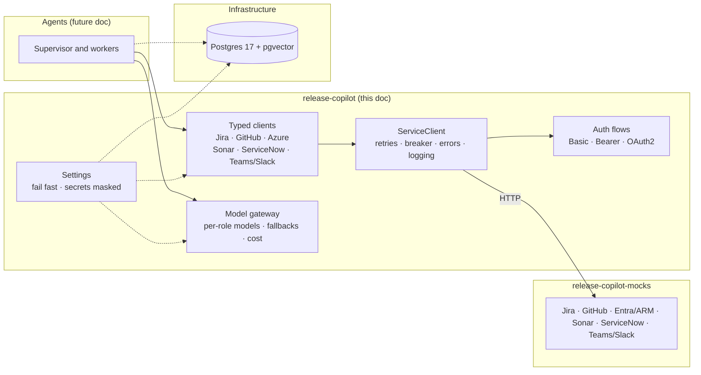
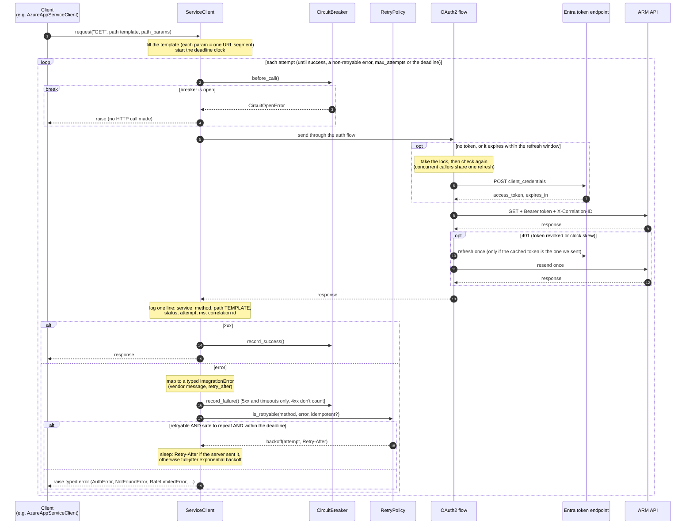
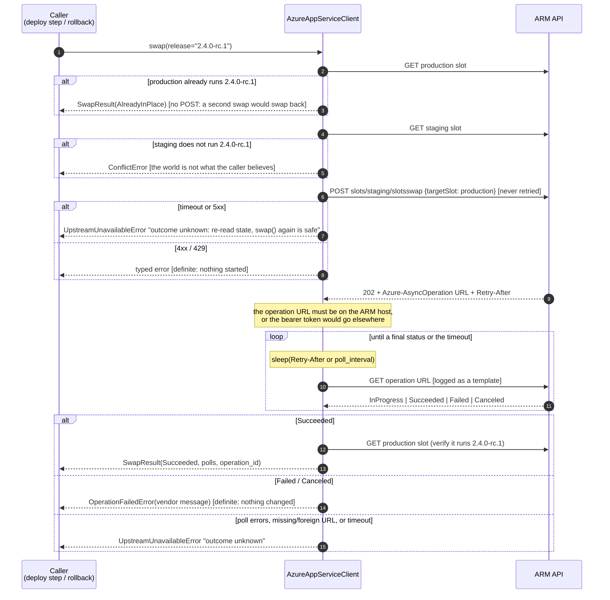

# Release Copilot: Foundations and Integration Layer, High-Level Design

**Status:** current as of T4 (Oct 2026) · **Scope:** platform foundations (F1–F3) and the integration layer (T1–T4).
Agents and agent-facing tools (T5, A\*) are in [design-agents-and-tools.md](design-agents-and-tools.md).

---

## 1. What this part of the system does

Release Copilot automates release paperwork and decisions for `payments-api`. Before any agent can reason, the
system needs **trustworthy evidence**: which tickets are in the release, what code changed, whether the checks
and security scans pass, and what is running in each Azure slot.

This layer's job is to fetch that evidence from enterprise systems **reliably, completely and safely**, and
hand it on as small, typed objects. It contains no AI. It is ordinary engineering, and it decides whether the
AI on top can be trusted at all.

## 2. Big picture

| Repository | Contains |
|---|---|
| `release-copilot` | Settings, model gateway, integration layer, and later agents, persistence, guardrails and evals |
| `release-copilot-mocks` | Fake enterprise APIs. A **dev-only** dependency: application code never imports it |

### 2.1 Life of one request

What happens inside `ServiceClient.request()` for an Azure call (OAuth2, so every layer is involved). Jira and
GitHub calls follow the same path with static Basic or Bearer auth, so there is no token step.

What to notice:
- **Steps 3–5:** an open breaker fails instantly. A struggling upstream gets breathing room, and agents don't burn their budget on timeouts.
- **The token step:** at most one token request at a time, however many calls are waiting (single flight).
- **The 401 branch:** recovers from a revoked token without involving the retry loop, and only once, so bad credentials can't loop.
- **The error branch:** a POST is not retried by default, and a `Retry-After` beyond the deadline gives up immediately instead of sleeping.

### 2.2 Slot swap: an idempotent long-running operation

`AzureAppServiceClient.swap(release=...)` turns a *toggle* ("swap the slots") into a *state* ("make sure
production runs release X"), and tells "failed" apart from "outcome unknown".

What to notice:
- **Rollback is the same call** with the previous release, `swap(release="2.3.1")`. No separate code path to get wrong.
- **Every exit after the POST** is either a *known* outcome (Succeeded, Failed) or explicitly *unknown*. A caller
  that gets "unknown" re-reads the state or calls `swap()` again. The first check makes that safe.

## 3. Work completed

| Story | What was built | Where |
|---|---|---|
| **F1** Mock enterprise services | Six vendor APIs copying the real paths, JSON and auth; six scenarios; fault injection; request log; approval callback | `release-copilot-mocks` |
| **F2** Local infrastructure | Docker Compose: Postgres 17 + pgvector and the mocks; least-privilege DB role and schema; Alembic; Makefile | `compose.yaml`, `docker/`, `migrations/` |
| **F2** Settings | One typed settings object; secrets masked; fails fast with errors that never contain values; production rules | `config.py` |
| **F3** Model gateway | Per-role chat models (OpenAI, Azure OpenAI, LiteLLM, fake), fallbacks, embeddings, token and cost tracking | `llm/` |
| **T1** HTTP core | Retries, circuit breaker, error types, auth flows, correlation ids, structured logging | `integrations/http.py`, `retry.py`, `breaker.py`, `errors.py`, `auth.py` |
| **T2** Jira + GitHub clients | Typed domain models with evidence ids, complete paging, Atlassian rich text to Markdown, idempotent release creation | `integrations/jira.py`, `github.py`, `adf.py`, `models.py` |
| **T3** Azure client | Slots, deployments, Monitor metrics, idempotent slot swap with long-running-operation polling | `integrations/azure.py` |
| **T4** SonarQube, ServiceNow, notifications | Measures and quality gate; change requests and approvals through an injection-safe query builder; Teams and Slack notifiers | `integrations/sonar.py`, `servicenow.py`, `notify.py` |
| **T5** Agent tool layer | Covered in its own doc | [design-agents-and-tools.md](design-agents-and-tools.md) |

About 170 automated tests cover this, all running without network access or a real LLM.

---

## 4. Key design decisions

Each decision lists **what** we chose, **why** it matters, and the **trade-off** we accepted.

### D1. Mocks live in their own repo and copy the real APIs exactly

**What.** The mocks reproduce each vendor's real URL paths, JSON shapes, auth schemes and error bodies:
Jira's rich text (ADF), GitHub's `Link` paging headers, Azure's `api-version` rule and long-running operations,
ServiceNow's reference fields. They sit in a separate repo that the agents repo uses only in tests.

**Why it matters.**
- Pointing the system at real services later means changing **base URLs and credentials only**, not code.
- Real-world problems show up early: truncated pages, a missing `head_sha`, branch names containing `/`, a
  swap that only takes effect when its operation completes. Each one we found became a fix in the client.
- Keeping the mocks out of the app means the app can't accidentally depend on test-only code.

**Trade-off.** We maintain the mocks, and their accuracy is only as good as our reading of the vendor docs.

### D2. Scenarios, fault injection and a request log are built into the mocks

**What.** Six scenarios describe the same release in different states: `clean`, `critical_cve`,
`coverage_drop`, `failed_deploy`, `prompt_injection` and `pii_in_ticket`. Each one records its **expected
outcome**. Faults (429, 503, latency, timeouts) can be injected per path, per scenario and per count. Every call
is logged.

**Why it matters.**
- The `expected` blocks become the **golden labels for evaluation** later. Test data and eval data come from one source.
- Fault injection lets tests *prove* resilience ("two 429s, then success on the 3rd attempt") instead of hoping.
- The request log shows exactly what a component called. That's the basis for later checks on *which tools an
  agent called*, for example that the agent never called an exfiltration URL.

### D3. One Postgres (with pgvector) for every kind of state, accessed by a least-privilege role

**What.** A single `pgvector/pgvector:pg17` container will hold the LangGraph checkpoints, long-term memory,
app tables and policy vectors. The app connects as `copilot_app`: not a superuser, unable to create databases
or roles, with its own `copilot` schema. `public` is closed.

**Why it matters.**
- One store keeps operations simple, and it's the standard production setup for LangGraph.
- Least privilege limits the damage from a bug or a compromised component. The app can't install extensions,
  create roles or write outside its schema, and tests check this against the live database.
- Alembic owns our tables, while LangGraph's libraries create their own. Keeping the two apart avoids migration fights.

**Trade-off.** Postgres isn't a specialised vector database. That's fine at our scale; pgvector's 2,000-dimension
index limit is why we keep embeddings at 1,536 dimensions.

### D4. Settings fail fast, and never leak secrets, even in error messages

**What.** One `Settings` object, nested per service (`RELEASE_COPILOT_JIRA__API_TOKEN`). Secrets are `SecretStr`.
URLs are validated at startup. Production adds rules: no `postgres` user, TLS to the database, `https` for every
integration.

**Why it matters.**
- A typo in a URL is caught **at startup**, not halfway through an agent run.
- A subtle trap we found: pydantic's validation errors keep the raw input, **secrets included**, and
  `hide_input_in_errors` only hides it from `str(e)`. `load_settings()` therefore re-raises a `SettingsError` that
  lists only *where* and *why*, and drops the original exception. Without this, one bad deploy would have sent
  every credential to the error tracker.
- The schema name is checked against a strict pattern because it ends up in SQL text.

### D5. Models come from one gateway, configured per role

**What.** `get_chat_model(role)` for `supervisor | worker | writer | judge`. The provider (OpenAI, Azure OpenAI,
LiteLLM, fake) is a setting. `get_resilient_model(role, prepare)` adds a fallback model.

**Why it matters.**
- **Fallbacks happen only on transient errors** (connection errors, timeouts, 429, 5xx). A 400 or 401 is a bug;
  falling back would hide it and double the cost.
- **Retries, timeouts and fallbacks add up.** With 3 retries × 30 s, an outage would wait about 2 minutes before
  the fallback. Primaries that have a fallback retry only once, and timeouts are set per role.
- **Trap:** `with_fallbacks()` loses `bind_tools()` and `with_structured_output()`, so `prepare` is applied to
  each model *before* the models are combined.
- **The judge must differ from the writer,** and be at least as capable. A model grading its own output is biased.
- **Cost tracking** happens per run through a callback, by role and model. An unknown price is reported as
  *unknown*, not zero.
- A **fake model** makes every test deterministic and free.

### D6. We own a typed integration layer instead of plugging in vendor SDKs or MCP servers

**What.** Our own clients over a shared HTTP core.

**Why it matters.**
- **Fixed workflow steps should be deterministic.** "Get every ticket in fix version 2.4.0" is not a decision for
  a model. Routing it through LLM tool selection adds cost, delay and randomness.
- **Vendor MCP servers are generic.** Their outputs are close to raw JSON and they often include write tools. We
  need compact outputs with evidence ids, guaranteed completeness, and writes that go through *our* policies.
- **We control reliability and can test it,** including failure injection.

**Trade-off and production note.** In production we'd wrap the official SDKs where they help, for example
`azure-identity` and `azure-mgmt-web` for token refresh and long-running operations. We wrote these by hand to
learn what those SDKs do. Vendor MCP servers remain a good option for open-ended, read-only exploration later.

### D7. One shared HTTP core handles retries, the circuit breaker and errors

Every client goes through `ServiceClient.request()`: check the breaker, send, map the error, retry if safe, wait.

**Retry rules (`RetryPolicy`):**
- Retry only *retryable* errors (connection problems, timeouts, 429, 5xx), and only when **repeating is safe**.
  GET, PUT and DELETE are safe; **POST is not retried by default**, because a timed-out POST may already have
  created a change request. Callers can opt in when they supply an idempotency key.
- A server's **`Retry-After` always wins**. Otherwise, exponential backoff with **full jitter**, so clients that
  failed together don't all retry at the same moment.
- A **total deadline** per call. A `Retry-After: 120` against a 30 s budget fails immediately instead of sleeping.

**Circuit breaker.** After 5 consecutive upstream failures it opens and calls **fail instantly** for a cool-down.
It then lets one trial call through. Only upstream failures count; a 404 is our mistake, not a sign the
upstream is unhealthy.

**Error types.** Callers, and later agents, branch on a *type*, never on vendor status codes:

| Error | Meaning | Retryable |
|---|---|---|
| `AuthError` | Bad or expired credentials (401; 400 from the token endpoint) | no |
| `PermissionDeniedError` | Not allowed (403, e.g. an ACL) | no |
| `PolicyViolationError` | A business rule refused the *action* (ServiceNow 403, e.g. "approval can only be set by an approver") | no |
| `NotFoundError` / `ConflictError` / `InvalidRequestError` | 404 / 409 / 400 and 422 | no |
| `RateLimitedError` | 429, carries `retry_after` | yes |
| `UpstreamUnavailableError` | 5xx, timeouts, connection failures; also "outcome unknown" | yes |
| `CircuitOpenError` | Breaker open, no call made | no |
| `OperationFailedError` | A long-running operation ended Failed or Canceled | no |

Each error carries the vendor's own message, extracted from six different error-body formats.

### D8. Auth runs as an HTTP flow, and the OAuth token is shared safely

**What.** Auth is an `httpx.Auth` flow, so every attempt, including retries, is authenticated. For Azure, the
OAuth2 client-credentials flow:
- **caches** the token and **refreshes it before expiry** (60 s early, but never more than half the token's lifetime);
- uses **single flight**: 10 concurrent calls cause exactly **one** token request (a lock with a second check inside);
- on a 401, refreshes **once** and retries **once**. It only discards the token if it's the one it sent, so a
  newer token fetched by a concurrent request is kept;
- classifies token-endpoint failures correctly: a bad secret is an `AuthError`, but an Entra 503 is a retryable
  `UpstreamUnavailableError`. We found and fixed the case where a one-second blip failed the whole call.

### D9. Vendor JSON stays inside the clients; everything else uses domain models with evidence ids

**What.** Clients return small, frozen Pydantic models: `Issue`, `Commit`, `PullRequest`, `CheckRun`,
`DependencyAlert`, `AppServiceSlot`, `MetricSeries`, and so on. Each piece of evidence has a stable id such as
`jira:PAY-102`, `gh:commit:abc1234`, `gh:dependabot:34` or `azure:slot:staging`.

**Why it matters.**
- **Fewer tokens, better reasoning.** A raw Jira issue is about 30 KB; `Issue` is about 1 KB.
- **Faithfulness becomes checkable.** The release document will cite evidence ids, and a validator, then an LLM
  judge, can verify every claim against them.
- **Vendor quirks stay in one place,** for example Jira's `+0000` time offsets or GitHub list endpoints leaving out `merged`.
- Jira's rich text is converted to **Markdown**, which keeps lists and code that plain text would lose. The
  converter never raises, because ticket content is untrusted input.

### D10. Never return partial evidence silently

**What.** This layer feeds release approvals. A missing ticket means a wrong decision, with no error anywhere.
- **Paging is driven by the next-page token.** A missing `isLast` can't end the loop early, and a token that
  never advances raises an error instead of looping forever or quietly stopping.
- **Jira comments embedded in an issue are only the first page.** When `total` is larger, the client fetches
  the rest, because a reviewer's "don't ship" could be on page 2.
- **Offset paging needs a stable order.** ServiceNow pages with `sysparm_offset`, and without an explicit order a
  record can appear on two pages or on none, especially when the table changes between requests. The client
  adds `ORDERBYsys_id` when a query has no order and never returns the same record twice. It reads until
  `X-Total-Count` records are in, and an empty page before that raises an error. (Cursor-based paging, like
  Jira's next-page token, avoids the problem by design.)
- **Only requested fields:** clients ask for exactly the fields they map, so payloads stay small and fields we
  didn't choose can't leak in.

### D11. Writes are idempotent by design, and ambiguity is reported honestly

**What.**
- **GitHub release creation is idempotent by tag.** If the release already exists, the client returns it.
- **A slot swap is a toggle, so we never "just swap".** The API is *"make sure production runs release X"*: check
  first; if it already does, nothing happens; if the source slot doesn't run X, refuse. Rollback is the same
  call with the previous release.
- **Approvals are requested per approver, idempotently.** Asking an approver who already has a record returns
  that record. A re-run never asks the same person twice, or leaves the change waiting on a duplicate nobody answers.
- **Change requests carry a `correlation_id`** (`payments-api@2.4.0`), and lookup by it is strict: two matches
  raise `ConflictError` instead of picking one, because silently choosing hides a duplicate. Find-before-create,
  built on this, is A6's job.
- **"Outcome unknown" is different from "failed".** If anything goes wrong after Azure may have accepted the
  swap (the request timed out, polling failed, the deadline passed), the client reports *outcome unknown* and
  says to re-read the state. A definite rejection (4xx, 429, or an operation that ended Failed) is reported as such.

**Why it matters.** Retries, network blips and duplicate agent runs are normal. A naive retry of a swap undoes
the release; a naive retry of a change-request POST creates a duplicate. Turning *"do the action"* into
*"ensure the state"* makes retries safe, and the same pattern applies to change requests later.

### D12. Security habits built into the HTTP layer

- **Logs contain path templates**, such as `/rest/api/3/issue/{key}`, never ids, query strings, bodies or
  tokens. That keeps them free of personal data and secrets, and cheap to aggregate.
- **Each path parameter is encoded as one URL segment,** so a value like `../admin` can't change the route.
- **Redirects aren't followed,** because a redirect would resend credentials to another host.
- **URLs from responses are only followed on the same host:** GitHub's next-page links reuse only their query
  string on our own path, and Azure's operation URL is polled only if it points at the ARM host. Otherwise a
  response could trick us into sending our bearer token elsewhere.
- **Correlation ids** (`X-Correlation-ID`) are attached to every call, so one run can be followed across services.

### D13. ServiceNow queries are built, never concatenated (query injection)

**What.** ServiceNow filters are *encoded query strings*: `cmdb_ci=<id>^state!=4^ORDERBYsys_id`, where `^`
means AND. Clients may only pass a `Q` object, built with `Q().eq(...).ne(...).order_by(...)`. A raw string is
rejected with `TypeError`.

**Why it matters.** Values come from tickets, agent output and users, so they are untrusted. Concatenated
into a string, a value like `x^ORsys_id!=` adds an OR branch that matches **every record**. That's the same
class of bug as SQL injection. `Q` closes it:
- every `^` in a value is escaped as `^^`, so it stays part of the value
- field names must match a strict pattern, so a "field" can't smuggle in operators
- values inside `IN` lists can't contain commas, because a comma can't be escaped there
- `Q` is immutable, so a shared base query can't be changed by accident

**Trade-off.** Only AND conditions are supported. OR queries can be added to `Q` when a story needs them, and
they'll get the same escaping.

### D14. Notifications are delivered at least once, and escaped

**What.** `TeamsNotifier` (Adaptive Card) and `SlackNotifier` (Block Kit) share one `Notifier` interface.
`notify_all()` sends to every configured channel and reports a result per channel.

**Why it matters.**
- **At least once, not at most once.** Sends are retried, so a rare duplicate message is possible. Losing an
  approval request is worse than seeing it twice, and the message is only a pointer: ServiceNow holds the real
  state. One failing channel doesn't stop the others.
- **Untrusted text is escaped for Slack.** Ticket titles and agent summaries could otherwise produce
  `<!channel>` pings or links whose visible text hides where they go.
- **The webhook URL is the credential.** It's never logged (requests appear as `{webhook}`). The client's base
  URL is only the webhook's scheme and host, and the secret path is sent per request. A whole webhook URL can't
  be the base, because httpx adds a trailing `/`. Posting to `…/path/` got a redirect, and since redirects
  aren't followed, it surfaced as an error the tests caught.

### D15. Testing approach

- **The mocks run inside the test process,** through `httpx.ASGITransport`: no server, no network.
- **A fake clock and a fake sleep** make retry, backoff, token expiry and breaker tests instant and deterministic.
- **Specs are written as tests first** (`test_retry.py`, `test_oauth.py`, `test_adf.py`, `test_jira.py`,
  `test_azure.py`, `test_servicenow.py`) and checked against a throwaway reference implementation, so the spec itself is known to be achievable.
- **`RewritingTransport`** edits mock responses to imitate vendor behaviour the mocks don't have, such as a
  missing `isLast`, truncated comments, a foreign operation URL, references without links, or a record repeated
  across pages.
- **Database tests** run against the real Postgres when `RELEASE_COPILOT_TEST_DATABASE_URL` is set, and are skipped otherwise.

---

## 5. Known limitations and follow-ups

| Item | Why it's acceptable for now | Where it gets addressed |
|---|---|---|
| POST is never retried, even after a 429 or connection refused (cases where the request was certainly not processed) | Safe, slightly too strict | Idempotency keys (A6) |
| A Jira issue with an unexpected shape raises a bare `KeyError` from the client | Rare; the mocks are well-formed | Done in T5: tools turn it into a structured `UnexpectedResponse` (agents doc, D19) |
| Bold or italic text that ends in a space renders as literal `**…**` | Cosmetic for an LLM reader | Small ADF fix |
| Race between checking the slots and swapping (another deployer acts in between) | Detected by the check after the swap | A7 change window / single writer |
| Hand-written OAuth and long-running-operation polling | A deliberate learning choice | Wrap `azure-identity` / `azure-mgmt-web` in production |
| Prices in `pricing.py` are hard-coded | Cost is advisory | Check against provider pricing before relying on it |
| `update_change` turns every 403 into `PolicyViolationError`, including ACL refusals | ServiceNow uses the same error shape for both | Refine if ACL errors show up in practice |
| `update_change` sends any field (no allow-list); a detected duplicate `correlation_id` reports `status=409` though no HTTP 409 occurred | Callers are internal; values are validated by ServiceNow | Typed update model in A6 |
| ServiceNow queries support AND only | No current story needs OR | Extend `Q` when one does |

## 6. Glossary

- **Evidence id:** stable reference to one fact (`jira:PAY-102`), cited by documents and checked by validators.
- **Idempotent:** doing it twice has the same effect as doing it once.
- **Full jitter:** wait a random time between 0 and the backoff cap, to spread retries out.
- **Circuit breaker:** stops calling a failing service for a while, so it can recover and callers fail fast.
- **Single flight:** concurrent callers share one in-progress operation, for example one token request.
- **Long-running operation (LRO):** an Azure request that returns `202` and a URL to poll until it finishes.
- **ADF:** Atlassian Document Format, the JSON tree Jira uses for rich text.
- **Encoded query:** ServiceNow's filter string (`field=value^field2!=x`); `^` means AND.
- **Query injection:** untrusted input changing the meaning of a query, because it was concatenated in, not escaped.
- **At-least-once delivery:** a message is retried until it's acknowledged, so it may arrive twice but isn't lost.
